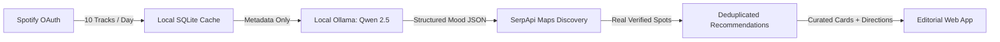

<div align="center">

# Feels 🌿

**Turn your music into a reason to get outside.**

An open-weight, privacy-first web application that translates your recent Spotify listening history into curated outdoor destinations using on-device AI and real-time map discovery.

[](https://python.org)
[](https://fastapi.tiangolo.com)
[](https://ollama.com)
[](https://huggingface.co/Qwen)
[](LICENSE)
[](https://dev.to/challenges/hf26)

[Live Demo](#quickstart) • [Architecture](#architecture) • [Configuration](#configuration) • [Deployment](#deployment)

</div>

---

## Overview

Most streaming apps use your listening history to feed more screen time, generating algorithmic queues engineered to keep you in your chair. 

**Feels** flips that dynamic around. 

Instead of another chatbot or infinite playlist, Feels treats your recent soundtrack as an unfiltered mirror of your mental headspace. It reads your 10 most recent tracks once per day, runs an open-weight model (**Qwen 2.5 Coder 7B**) locally on your machine to analyze tempo, energy density, and emotional cadence, and grounds that mood in real-world outdoor spaces using **SerpApi's Google Maps engine**.

You get three curated physical destinations - elevated ridge trails, shaded forest loops, or quiet lake sanctuaries - complete with verified user ratings, photos, grounded atmospheric reasoning, and one-click Google Maps directions.

> **Intentional Screen Limits:** Feels enforces a strict calendar day cap of **15 refreshes**. You find your spot, shut your laptop, and go outside.

---

## How It Works



1. **Daily Sync:** Connect your Spotify account via OAuth. Feels reads your 10 most recent tracks at most once per calendar day.
2. **On-Device Cognition:** The local Qwen 2.5 Coder model synthesizes acoustic attributes into an outdoor mood profile without sending music data to any third-party cloud LLM.
3. **Grounded Search:** The profile generates environmental search intents queried through SerpApi against Google Maps for your configured region.
4. **Curated Action:** The UI reveals three verified spots paired with ratings, photos, and direct walking/driving routes.

---

## Key Features

- **100% Private On-Device AI:** Your listening history never leaves `localhost`. Inference runs entirely via Ollama with zero marginal cloud token costs.
- **Grounded in Physical Reality:** No hallucinated venues. Spots are verified points of interest with real reviews, live hours, and coordinates.
- **Anti-Addiction Quotas:** Hard limits of 15 refreshes per day ensure technology acts as a gateway to the outdoors, not a trap.
- **Offline Resilience:** Cached regional data and local model weights ensure mood profiling works even on low-signal trailheads.
- **Tactile Editorial UI:** Built with Vanilla CSS and modern JavaScript, featuring a four-stage progress pipeline and editorial typography.

---

## Architecture

| Component | Technology | Purpose |
| :--- | :--- | :--- |
| **Backend** | FastAPI (Python 3.10+) | High-performance asynchronous API & static serving |
| **Local AI** | Ollama (`qwen2.5-coder:7b`) | On-device structured JSON mood profiling |
| **Discovery** | SerpApi (Google Maps Engine) | Real-world venue search, reviews, and photography |
| **Storage** | SQLite (WAL mode) | Daily rate limiting, session cache, and place rotation |
| **Frontend** | Vanilla HTML5, CSS3, ES6 JS | Fast, responsive editorial neobrutalism interface |
| **Deployment** | Render Blueprint (`render.yaml`) | Zero-friction containerized web service deployment |

---

## Quickstart

### Prerequisites

1. **Python 3.10+**
2. **Ollama** installed ([ollama.com](https://ollama.com)) with the model ready:
   ```bash
   ollama pull qwen2.5-coder:7b
   ```
3. Spotify Developer App credentials ([developer.spotify.com](https://developer.spotify.com/dashboard))
4. SerpApi API key ([serpapi.com](https://serpapi.com)) *(optional: mock data included for instant demo)*

### Installation

```bash
# 1. Clone repository
git clone https://github.com/prathamanvekar/feels.git
cd feels

# 2. Install dependencies
pip install -r requirements.txt

# 3. Configure environment
cp .env.example .env

# 4. Start local Ollama server
ollama serve

# 5. Launch Feels
python -m uvicorn app.main:app --host 127.0.0.1 --port 8000 --reload
```

Open your browser at:
- **Landing Page:** [http://127.0.0.1:8000/](http://127.0.0.1:8000/)
- **Main App:** [http://127.0.0.1:8000/app](http://127.0.0.1:8000/app)

*(Don't have Spotify credentials right now? Click **"⚡ Try Sample Session (Instant Demo)"** to run the complete pipeline with pre-built audio fixtures).*

---

## Configuration

Settings are managed via `.env`:

```env
# Spotify Developer Credentials
SPOTIFY_CLIENT_ID="your_spotify_client_id"
SPOTIFY_CLIENT_SECRET="your_spotify_client_secret"
SPOTIFY_REDIRECT_URI="http://127.0.0.1:8000/auth/callback"

# SerpApi Configuration
SERPAPI_API_KEY="your_serpapi_key"
SERPAPI_DAILY_BUDGET=15

# Geographic Target & Daily Limits
TARGET_CITY="Pune, Maharashtra, India"
USER_DAILY_REFRESH_LIMIT=15
APP_TIMEZONE="Asia/Kolkata"

# Local AI Engine
OLLAMA_BASE_URL="http://127.0.0.1:11434"
OLLAMA_MODEL="qwen2.5-coder:7b"
```

---

## Deployment

Feels is ready for one-click deployment on **Render** using the bundled `render.yaml` blueprint:

```yaml
services:
  - type: web
    name: feels-outdoor-matcher
    runtime: python
    buildCommand: pip install -r requirements.txt
    startCommand: uvicorn app.main:app --host 0.0.0.0 --port $PORT
    healthCheckPath: /api/health
```

---

## Automated Tests

Run the full suite of unit and concurrency integration tests:

```bash
python -m pytest tests -v
```

All 21 tests pass across:
- **Rate limiting:** Atomic thread-safe quotas and budget exhaustion under concurrent load.
- **Local AI:** Deterministic JSON schema extraction, markdown fence stripping, and fallback handling.
- **Search & Cache:** Query normalization, deduplication, and place rotation.
- **API Endpoints:** Authentication lifecycle, HTTP 429 status codes, and health diagnostics.

---

## License

This project is open source and available under the [MIT License](LICENSE). Built for the Hacktoberfest 2026 Open-Source AI Challenge.
